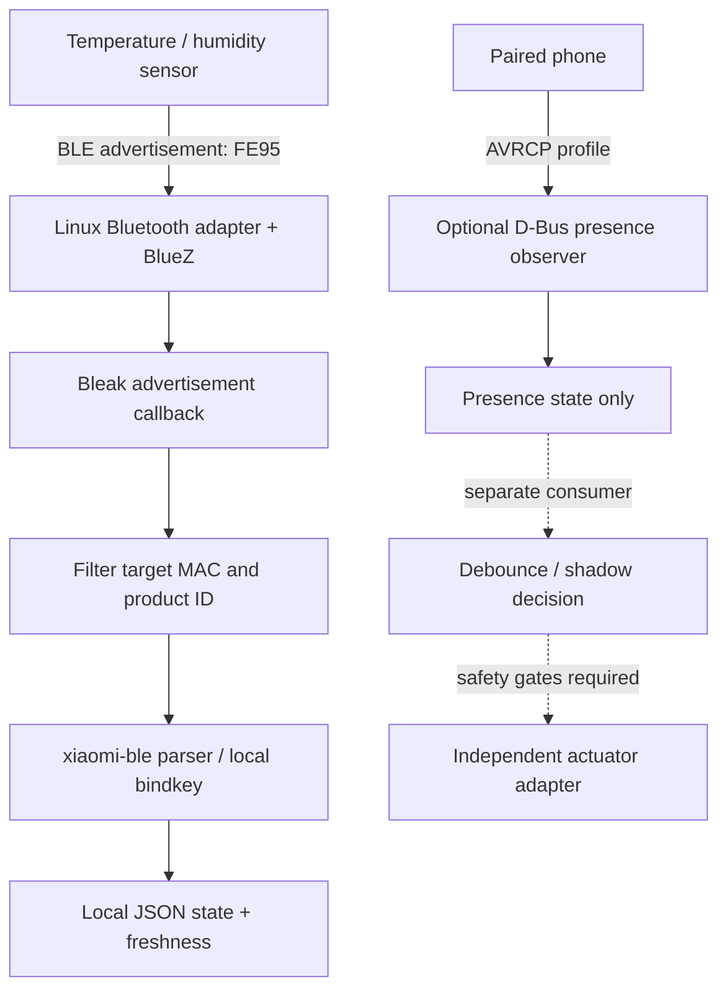

# Local Xiaomi/Mijia BLE Bridge for Linux

**Receive Xiaomi/Mijia temperature and humidity data locally on Linux/Armbian without a Bluetooth Mesh gateway.** The reference implementation listens for BLE advertisements, decodes the FE95/MiBeacon payload with the upstream `xiaomi-ble` parser, and writes a small local JSON state file.

中文简介：本项目记录并整理一条已经在 Linux/Armbian N1 上实测的本地接入路线：米家温湿度计通过 BLE 广播发送数据，Linux 蓝牙适配器被动接收，`xiaomi-ble` 在本机解码，温湿度写入本地 JSON。**不需要蓝牙 Mesh 网关，不建立 GATT 连接，不依赖云端轮询。**

> **Scope and safety:** the temperature/humidity receiver and optional phone-presence observer are independent. The phone observer never controls a plug. This repository does not contain a production smart-plug actuator, account credentials, device-specific MAC addresses, bindkeys, or raw production logs.

## What is demonstrated

- **Sensor path:** BLE advertisements → BlueZ/Bleak → FE95 service-data filtering → `xiaomi-ble` parsing/decryption → local JSON state with observation timestamps, freshness, counters, and sanitized error classes.
- **Optional presence path:** observe a paired phone's AVRCP profile through BlueZ D-Bus; request only that profile with `org.bluez.Device1.ConnectProfile`; retry with bounded exponential backoff instead of launching `bluetoothctl` every few seconds.
- **Safe automation pattern:** keep observation, debounced/shadow decisions, and any actuator in separate components. The reference phone observer never switches power.

## Tested reference device

The original reference device was a Xiaomi/Mijia Temperature and Humidity Monitor 3 Mini (`MJWSD06MMC`, model `xiaomi.sensor_ht.mini`, product ID `0x55B5`) running stock firmware. The N1 ran Armbian with BlueZ. The production receiver successfully decoded temperature and humidity from FE95 advertisements and survived a host reboot. Device MAC, bindkey, live readings, private LAN details, and raw logs are intentionally not published.

The upstream Home Assistant Xiaomi BLE documentation explains the broadcast-based approach and notes that some MiBeacon v4/v5 devices use AES-CCM encryption with a 32-character hexadecimal (16-byte) bindkey. The `xiaomi-ble` parser already lists support for `MJWSD06MMC`; this repository provides a standalone Linux receiver around that parser.

References:

- [Home Assistant: Xiaomi BLE](https://www.home-assistant.io/integrations/xiaomi_ble)
- [Bluetooth-Devices/xiaomi-ble](https://github.com/Bluetooth-Devices/xiaomi-ble)
- [Upstream changelog: MJWSD06MMC support](https://github.com/Bluetooth-Devices/xiaomi-ble/blob/main/CHANGELOG.md)
- [BlueZ Device D-Bus API](https://github.com/bluez/bluez/blob/master/doc/org.bluez.Device.rst)

## Architecture



The dashed actuator path is an architectural pattern, **not an included plug-control implementation**. Sensor readings do not trigger plug actions in this reference project.

## Install (Debian / Armbian)

1. Install the system prerequisites:

   ```bash
   sudo apt update
   sudo apt install -y bluez python3-venv
   ```

2. Place the repository at `/opt/mijia-ble-bridge`, create a virtual environment, and install the dependencies:

   ```bash
   sudo python3 -m venv /opt/mijia-ble-bridge/.venv
   sudo /opt/mijia-ble-bridge/.venv/bin/pip install -r /opt/mijia-ble-bridge/requirements.txt
   ```

3. Create `/etc/mijia-ble-bridge.env` from `.env.example`. Replace both `XX:XX:XX:XX:XX:XX` placeholders with the intended device addresses. The sensor address is required; the phone address is only needed if you choose to enable the optional presence observer.

4. Put the sensor bindkey in `/etc/mijia-ble-bridge/bindkey` as exactly 32 hexadecimal characters (16 bytes), with ownership `root:root` and mode `0600`. Never put the key in `.env`, source code, logs, issue reports, or Git.

   ```bash
   sudo install -d -o root -g root -m 0700 /etc/mijia-ble-bridge
   sudo install -o root -g root -m 0600 /dev/null /etc/mijia-ble-bridge/bindkey
   sudoedit /etc/mijia-ble-bridge/bindkey
   sudo chmod 0600 /etc/mijia-ble-bridge/bindkey
   ```

5. Install the receiver service and start it:

   ```bash
   sudo install -o root -g root -m 0644 systemd/mijia-ble-receiver.service /etc/systemd/system/
   sudo systemctl daemon-reload
   sudo systemctl enable --now mijia-ble-receiver.service
   sudo systemctl status mijia-ble-receiver.service
   ```

6. Read the local state (do not publish the output without redacting the configured MAC):

   ```bash
   sudo jq '{status, temperature_c, humidity_percent, temperature_observed_at, humidity_observed_at, advertisement_count, parsed_frame_count, parse_error_count}' /var/lib/mijia-ble-bridge/advertisement-state.json
   ```

### Optional: phone presence observer

The presence observer is independent of sensor reception. If you need it, install `systemd/phone-presence-observer.service` and enable it only after pairing the intended phone and setting `PHONE_BT_ADDRESS`. It observes and requests the AVRCP profile only; it does **not** turn a smart plug on or off. A separate shadow/actuator integration must implement freshness checks, debounce, exact target identity, fault checks, and write/readback verification.

### Optional: Apple Home (without installing Home Assistant)

The optional HomeKit adapter reads the existing local sensor-state JSON and exposes temperature and humidity as two read-only HomeKit accessories. It does not access Bluetooth or bindkeys and cannot control a smart plug. Install it separately with `requirements-homekit.txt`; pairing and mDNS requirements are documented in [`docs/homekit.md`](docs/homekit.md).

## Tests

The local tests cover the retry policy, error classification, and use of the targeted BlueZ D-Bus profile method. They do not emulate a real radio or claim that every phone/sensor combination is compatible.

```bash
python3 -m unittest discover -s tests -v
python3 -m py_compile src/mijia_ble_receiver.py src/phone_presence_observer.py
```

## Troubleshooting

See [`docs/diagnostics.md`](docs/diagnostics.md) for stale readings, bindkey/decode failures, BLE adapter state, and noisy reconnection logs. Do not repeatedly pair/unpair, connect to a non-connectable sensor over GATT, or restart the whole Bluetooth service as a first diagnostic step.

## Security

See [`docs/security.md`](docs/security.md). Keep bindkeys and real device addresses in local configuration only. This repository deliberately excludes private production configuration and raw logs.

## License

MIT; see [`LICENSE`](LICENSE).
