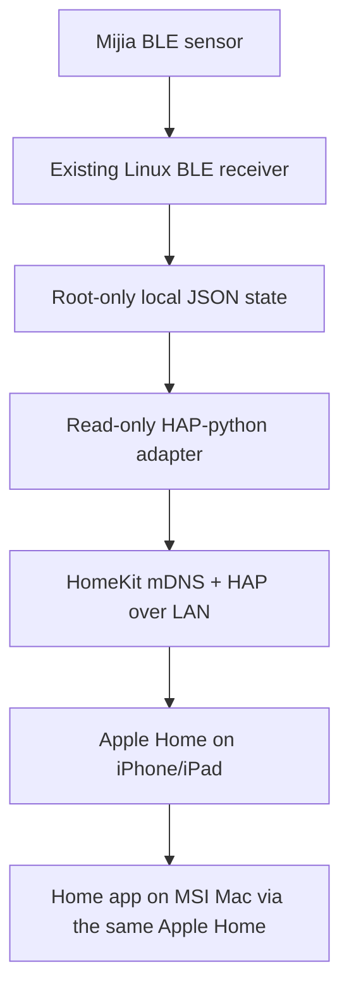

# Optional Apple Home bridge (no Home Assistant required)

The HomeKit adapter exposes the existing Linux receiver's temperature and humidity readings to Apple Home. It does **not** install Home Assistant or Homebridge, does not access Bluetooth or the sensor bindkey, and never controls a plug.

## Data path



The bridge exports two child accessories: `N1 Mijia Temperature` and `N1 Mijia Humidity`. It only serves a snapshot when the receiver reports `status=ok`, `decode_verified=true`, valid values, and fresh observation timestamps. Data older than 300 seconds is treated as unavailable rather than deliberately re-publishing an old reading as current.

## Install on Debian / Armbian

This assumes the existing receiver writes `/var/lib/mijia-ble-bridge/advertisement-state.json` as a root-owned `0600` file. If your receiver uses a different path, set `N1_MIJIA_STATE_PATH` in the environment file and update the unit's `ReadOnlyPaths` to match.

1. Install the optional HAP dependency in a separate virtual environment:

   ```bash
   sudo python3 -m venv /opt/mijia-ble-bridge/.homekit-venv
   sudo /opt/mijia-ble-bridge/.homekit-venv/bin/pip install -r requirements-homekit.txt
   ```

2. Install the adapter and unit:

   ```bash
   sudo install -o root -g root -m 0755 src/n1_mijia_homekit.py /usr/local/libexec/n1-mijia-homekit.py
   sudo install -o root -g root -m 0644 systemd/n1-mijia-homekit.service /etc/systemd/system/
   ```

3. Generate a random HomeKit setup code in a root-only environment file. Do not put the code in source control, command history, or public logs:

   ```bash
   sudo /opt/mijia-ble-bridge/.homekit-venv/bin/python - <<'PY'
   import os
   from pathlib import Path
   from pyhap.util import generate_pincode

   path = Path('/etc/n1-mijia-homekit.env')
   fd = os.open(path, os.O_WRONLY | os.O_CREAT | os.O_EXCL, 0o600)
   with os.fdopen(fd, 'w', encoding='ascii') as handle:
       handle.write('N1_HOMEKIT_PINCODE=' + generate_pincode().decode('ascii') + os.linesep)
       handle.write('N1_MIJIA_STATE_PATH=/var/lib/mijia-ble-bridge/advertisement-state.json' + os.linesep)
   PY
   ```

   The service intentionally does not print the setup code or QR payload into the journal. Keep `/etc/n1-mijia-homekit.env` and `/var/lib/n1-mijia-homekit/accessory.state` root-only (`0600` file, `0700` directory). If you need to retrieve the code locally, use `sudo sed -n 's/^N1_HOMEKIT_PINCODE=//p' /etc/n1-mijia-homekit.env`.

4. Validate and enable the service:

   ```bash
   sudo systemd-analyze verify /etc/systemd/system/n1-mijia-homekit.service
   sudo systemctl daemon-reload
   sudo systemctl enable --now n1-mijia-homekit.service
   sudo systemctl status n1-mijia-homekit.service
   ```

5. On an iPhone or iPad connected to the same LAN, open Apple Home, add an accessory, select `N1 Mijia BLE Bridge`, and enter the configured setup code. After it is added to the same Apple Home, the sensors should also appear in the Home app on the MSI Mac.

## Network and troubleshooting

- HomeKit discovery uses IPv4 mDNS (`_hap._tcp.local`, UDP 5353); the accessory serves HAP on TCP 51826. Keep the phone/tablet and N1 on the same LAN with multicast/mDNS permitted. Guest Wi-Fi/client isolation or routed VLANs without an mDNS reflector can prevent discovery.
- Check `systemctl status n1-mijia-homekit.service`, `journalctl -u n1-mijia-homekit.service`, and run `N1_MIJIA_STATE_PATH=/var/lib/mijia-ble-bridge/advertisement-state.json /opt/mijia-ble-bridge/.homekit-venv/bin/python /usr/local/libexec/n1-mijia-homekit.py --check-state`.
- If the source sensor is stale or invalid, the HomeKit sensor accessories become unavailable. Fix the original BLE receiver first; do not install another HA instance just to relay these two values.
- Pairing data and the stable setup code must be backed up privately. Deleting `accessory.state` resets the HomeKit bridge identity and can require removing/re-adding it in Apple Home; do not delete it as a routine troubleshooting step.
